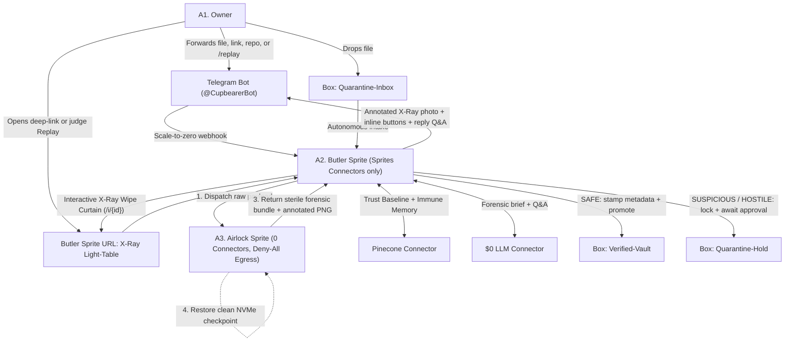
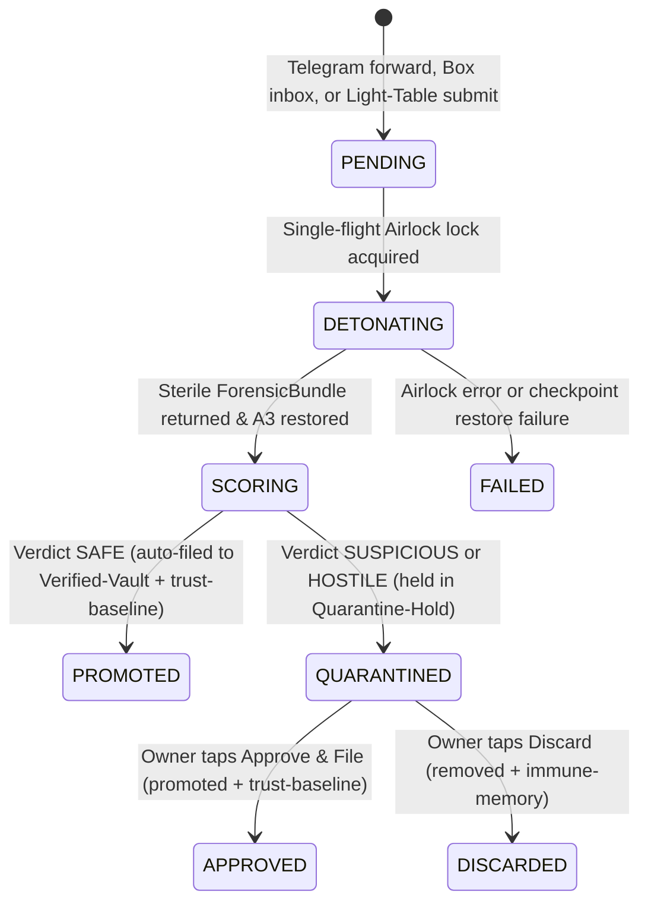

# Cupbearer - Plan

## Goal Capsule

- **Objective:** A solo developer can drop any untrusted PDF, link, script, repository, or AI agent skill into their workflow and receive verified clean files or deterministic proof of hidden attacks without exposing their laptop or connected accounts.
- **Means:** Cupbearer running as a single Python codebase across two Fly.io Sprites (connector-free Airlock + persistent Butler) wired exclusively through Fly.io Sprites Connectors on $0 free tiers (KTD1, KTD2, KTD7, KTD8).
- **Product Authority:** Sole product contract for Hacksgiving 2026 v1; deferred channels and non-goals stay out of active scope.
- **Execution Profile:** Single PR / single repository build (U1 through U6 in dependency order), verified locally via `uv run pytest` and on Fly.io Sprites via live smoke check before Sunday, November 29, 2026 at midnight PST.
- **Stop Conditions:** Halt implementation if any Sprites Connector requires storing a raw third-party credential inside A2 or A3, if A3 checkpoint restore fails to reset dirty state, or if a required service cannot operate within $0 free tiers.
- **Ownership:** `ce-work` implements U1–U6 and verifies local suites; the owner provisions free-tier Fly.io/Telegram/Box/Pinecone/LLM Connectors and records the Hacksgiving demo video.
- **Open Blockers:** None.

---

## Product Contract

### Summary

Cupbearer is a $0-out-of-pocket autonomous personal poison-taster agent on Fly.io Sprites that lives in **Telegram** and protects your personal Box vault using a two-Sprite Double-Blind Airlock. Forward any sketchy PDF, link, script, or AI skill to Cupbearer in Telegram (or drop it into your Box quarantine inbox): a persistent **Butler Sprite** dispatches it to an ephemeral, connector-free **Airlock Sprite** that detonates it surrounded by fake canary secrets, diffs visible rendering against hidden text/metadata, and rolls back to a clean NVMe checkpoint after every run. Using Sprites Connectors exclusively, Cupbearer replies right in Telegram with an annotated X-Ray image, Pinecone Trust Baseline and Immune Memory findings, inline Approve/Discard buttons, conversational follow-up Q&A, and a deep-link to an interactive X-Ray Light-Table on its Sprite URL.

### Problem Frame

Developers and builders routinely receive untrusted PDFs, client invoices, unfamiliar links, and third-party GitHub repositories or AI agent skills (`SKILL.md`, setup scripts, packages). Opening those artifacts locally risks credential theft or hostile execution, while handing them directly to a personal AI agent creates a confused-deputy risk: invisible prompt injections embedded in documents or web pages can hijack the agent's connected storage, memory, or messaging tools even when raw API keys are hidden. Existing workarounds force a painful tradeoff between manual caution (slow, error-prone, misses white-on-white prompt injections or subtle invoice/skill mutations) and generic single-sandbox LLM scanners that offer opaque vibes instead of deterministic proof.

### Key Decisions

- **Build a personal pre-flight security agent for the Grand Prize** (session-settled: user-approved — chosen over a generic personal assistant or Weird Uncle comedy bot: uniquely showcases Fly.io's hardware isolation, checkpoints, egress policies, and zero-secret Connectors). Governs R1, R2, R3.
- **Make Telegram the primary personal-agent surface paired with a focused Sprite URL X-Ray Light-Table deep-link** (session-settled: user-directed — chosen over a web-dashboard-first Desk: feels like a genuine personal agent you forward files and links to in chat, auto-wakes Butler via scale-to-zero webhooks at $0, and keeps the web UI focused on the interactive X-Ray Wipe Curtain and judge Attack Replays). Governs R9, R13, R14, R15.
- **Enforce a strict $0 free-tier dependency budget** (session-settled: user-directed — chosen over paid partner tiers like TypeSafe AI prepaid packs or metered cloud inference: guarantees the entire project builds and runs on free tiers and credits). Governs R16.
- **Pick the cleanest working $0 LLM Sprites Connector without forcing extra tooling** (session-settled: user-directed — chosen over forcing every hackathon sponsor logo regardless of friction: prioritizes reliability and shippable quality before Sunday's deadline). Governs R12, R16.
- **Isolate untrusted execution in a second, connector-free Airlock Sprite with per-run checkpoint rollback** (session-settled: user-approved — chosen over a single-Sprite agent: closes the confused-deputy gap so a hijacked detonation cannot touch Box, Pinecone, or LLM connectors). Governs R1, R2, R3, R4.
- **Use deterministic canary tripwires and visual-vs-raw X-Ray diffs alongside LLM synthesis** (session-settled: user-approved — chosen over LLM-only risk scoring: yields verifiable proof of credential theft and invisible prompt injections). Governs R5, R6, R7, R8.
- **Split outbound network policy between offline detonation and controlled-fetch-then-offline execution** (session-settled: user-approved — chosen over blanket internet access in the sandbox: lets URL and repository checks fetch targets while preventing hostile code from phoning home during execution). Governs R3.
- **Auto-promote `SAFE` Box inbox items while locking `SUSPICIOUS` and `HOSTILE` items behind explicit human approval** (session-settled: user-approved — chosen over auto-filing everything or blocking every clean file: keeps daily workflow hands-free without letting compromised artifacts enter the trusted vault). Governs R10, R13.
- **Ship three built-in harmless Attack Replay fixtures in Telegram and the Sprite URL X-Ray Light-Table** (session-settled: user-approved — chosen over requiring judges to craft malicious test payloads: guarantees a reproducible, one-tap 60-second demo). Governs R15.

### Actors

- A1. **Owner (Solo Developer):** Forwards untrusted artifacts to Cupbearer in Telegram (or drops them in Box or the X-Ray Light-Table), reviews quarantined verdicts, asks follow-up questions in chat, and approves or discards held items.
- A2. **Butler Agent (Persistent Sprite):** Autonomous personal agent running the Telegram webhook and focused X-Ray Light-Table at its Sprite URL, watching the Box inbox, orchestrating Airlock runs, maintaining Pinecone memory, updating Box folders/metadata, and answering owner questions through Sprites Connectors.
- A3. **Airlock Sandbox (Ephemeral/Checkpointed Sprite):** Hardware-isolated Linux environment with zero Sprites Connectors, planted fake canary credentials, and externally enforced egress network policy that detonates one artifact per run and rolls back to a clean NVMe checkpoint.
- A4. **Connected Services (via Sprites Connectors):** Telegram Bot API (primary owner chat & inline controls via Custom API Connector), Box (personal inbox, hold, and verified vault with metadata), Pinecone (Trust Baseline and Immune Memory), and the active $0 LLM provider (Google Gemini free tier, with Ollama Cloud only if its live probe confirms usable $0 starter capacity).

### Requirements

**Two-Sprite Double-Blind Airlock & Isolation**

- R1. Raw untrusted payloads shall execute and parse exclusively inside A3 (Airlock Sprite), never on A2 (Butler Sprite).
- R2. A3 shall have zero Sprites Connectors attached, and neither A2 nor A3 shall store raw third-party API keys or OAuth tokens on disk or in environment variables.
- R3. A3 shall run under an externally enforced deny-all outbound network policy during PDF and local script detonation; URL and repository inspections shall permit only controlled target fetching before cutting outbound network access prior to execution.
- R4. Immediately after returning a sterile forensic bundle to A2, A3 shall restore its root filesystem to a verified clean baseline checkpoint before accepting another inspection.

**Deterministic Detonation & X-Ray Inspection**

- R5. Before every execution in A3, the sandbox shall plant clearly marked fake canary secrets (such as decoy environment tokens and decoy SSH/cloud credential files) and record a deterministic tripwire hit if the payload reads, prints, or attempts to exfiltrate any canary.
- R6. For PDFs and documents, A3 shall render visible pages as images, diff visible content against extracted raw text and document metadata to surface invisible prompt injections (such as white-on-white text, tiny fonts, zero-width characters, or metadata payloads), and produce a sanitized copy stripped of active metadata and trackers.
- R7. For unfamiliar links, A3 shall open the target in a headless browser, capture rendered page screenshots, record the full redirect chain and attempted network destinations, and extract hidden DOM text that diverges from visible content.
- R8. For untrusted scripts, repositories, or AI agent skills, A3 shall inspect and run the payload under syscall/file/network observation against the planted canaries (per R5) and report every touched sensitive path, spawned command, and blocked outbound attempt.

**Autonomous Vault Workflow, Personal Memory & Verdicts**

- R9. A2 shall autonomously accept forwarded files, links, repos, and commands from A1 in Telegram (via webhook) as well as new items arriving in Box `Quarantine-Inbox` or submitted on the Sprite URL demo view.
- R10. A2 shall classify every inspected item into one of three schema-validated verdicts—`SAFE`, `SUSPICIOUS`, or `HOSTILE`—stamp structured verification metadata and an X-Ray certificate onto the Box item, auto-promote `SAFE` Box inbox items to `Verified-Vault`, move `SUSPICIOUS` or `HOSTILE` items to `Quarantine-Hold`, and notify A1 in Telegram with an annotated X-Ray image and inline Approve/Discard controls.
- R11. A2 shall maintain two Pinecone namespaces: `trust-baseline` for previously verified documents, senders/vendors, and skills to flag subtle drift like changed wire details or mutated skills, and `immune-memory` for previously caught attack patterns to semantically recognize reworded prompt injections.
- R12. A2 shall use a single swappable $0 LLM Sprites Connector to synthesize plain-English forensic briefs, structured verdict rationales, and owner Q&A responses from the sterile bundle and Pinecone matches.

**Telegram Chat Interface, X-Ray Light-Table & Demoability**

- R13. A2 shall reply to A1 in Telegram with an annotated X-Ray image (or canary tripwire summary), inline **Approve & File to Box**, **Discard**, and **Open Interactive X-Ray** buttons, and serve a focused X-Ray Light-Table view at its Sprite URL (`GET /` and `GET /i/{id}`) featuring an interactive wipe curtain over rendered pages, canary/network/Pinecone evidence, and Approve/Discard controls.
- R14. A1 shall be able to ask follow-up questions about any inspected item either by replying to Cupbearer's message in Telegram or via the scoped Q&A input on the item's X-Ray Light-Table page.
- R15. Both Telegram (`/replay invoice`, `/replay skill`, `/replay link`) and the Sprite URL Light-Table shall expose three built-in, harmless Attack Replay fixtures—a rigged invoice PDF with invisible white-on-white prompt injection and altered bank details, a deceptive redirect link, and a credential-stealing AI skill script—so A1 or a judge can trigger deterministic X-Ray and canary tripwires in one tap.

**Cost & Platform Budget**

- R16. The complete v1 deployment shall operate within $0 free tiers and credits: at most two concurrent Sprites on the Fly.io Free Plan, Box Free Developer quotas, Pinecone Starter quotas with integrated embeddings, and a $0-tier LLM Sprites Connector.

### Key Flows



- F1. **Autonomous Box Inbox Inspection**
  - **Trigger:** A1 drops a new PDF, invoice, or script into Box `Quarantine-Inbox`.
  - **Actors:** A1, A2, A3, A4
  - **Steps:** A2 detects the new file via the Box Connector and dispatches it to A3; A3 detonates it offline with planted canaries, extracts visible renders, an annotated X-Ray PNG, hidden text/metadata diffs, and a sanitized copy, returns the sterile bundle, and restores its clean checkpoint; A2 queries Pinecone (`trust-baseline` and `immune-memory`), computes the structured verdict and brief via the $0 LLM Connector, stamps verification metadata on Box, routes the file to `Verified-Vault` (`SAFE`) or `Quarantine-Hold` (`SUSPICIOUS`/`HOSTILE`), and notifies A1 in Telegram.
  - **Outcome:** Clean files appear verified in `Verified-Vault` with zero manual steps; risky files are held safely with an instant Telegram X-Ray alert and inline controls.
  - **Covered by:** R1, R2, R3, R4, R5, R6, R9, R10, R11, R12, R13

- F2. **On-Demand Telegram or Light-Table Detonation**
  - **Trigger:** A1 forwards a file, URL, GitHub repository, or AI agent skill to Cupbearer in Telegram (or triggers an Attack Replay via `/replay` or the Sprite URL Light-Table).
  - **Actors:** A1, A2, A3, A4
  - **Steps:** A2 sends the target to A3; A3 fetches remote targets under controlled egress, cuts outbound network before script execution, plants canaries, runs PDF/browser/execution observation, returns screenshots, annotated X-Ray PNG, redirect chain, and tripwire telemetry, and restores its clean checkpoint; A2 cross-checks Pinecone, produces the verdict and brief, replies in Telegram with the X-Ray photo and inline buttons, and publishes the specimen at `/i/{id}` on the Light-Table.
  - **Outcome:** A1 sees visual proof of what the document, link, or skill actually does—including any canary theft or blocked exfiltration attempt—without touching their laptop.
  - **Covered by:** R1, R2, R3, R4, R5, R6, R7, R8, R9, R11, R12, R13, R15

- F3. **Human Review, Follow-Up Q&A, and Vault Promotion**
  - **Trigger:** A1 receives a `SUSPICIOUS` or `HOSTILE` verdict in Telegram or opens its `/i/{id}` deep-link on the X-Ray Light-Table.
  - **Actors:** A1, A2, A4
  - **Steps:** A1 drags the interactive X-Ray Wipe Curtain (or reviews the in-chat annotated X-Ray) and asks a follow-up question by replying in Telegram or using the Light-Table Q&A input; A2 answers using the sterile bundle and Pinecone matches; A1 taps either **Approve & File to Box** (promoting the sanitized copy to `Verified-Vault` and updating `trust-baseline`) or **Discard** (removing from hold and recording the attack pattern in `immune-memory`).
  - **Outcome:** Human judgment resolves ambiguous cases while continuously sharpening the agent's personal memory.
  - **Covered by:** R10, R11, R12, R13, R14

### Acceptance Examples

- AE1. **Invisible Prompt Injection + Trust Baseline Drift (PDF Invoice)**
  - **Covers:** R1, R4, R6, R10, R11, R15
  - **Given:** A verified October invoice from "Acme Corp" exists in `Verified-Vault` and Pinecone `trust-baseline`.
  - **When:** A1 triggers the rigged November Acme invoice fixture containing white-on-white prompt injection text and an altered bank routing number.
  - **Then:** A3 surfaces the hidden injection text visually in the X-Ray diff and rolls back to its clean checkpoint; A2 flags the routing-number drift against October's baseline, classifies the item `HOSTILE`, holds it in `Quarantine-Hold`, and leaves `Verified-Vault` untouched.

- AE2. **Canary Secret Exfiltration Attempt (AI Skill / Script)**
  - **Covers:** R2, R3, R4, R5, R8, R15
  - **Given:** A3 has zero Connectors, deny-all egress during execution, and planted fake canary credentials.
  - **When:** A1 runs the credential-stealing AI skill fixture that reads environment tokens and attempts an outbound HTTP POST.
  - **Then:** A3 records a deterministic canary tripwire hit and the blocked outbound attempt, restores its clean checkpoint, and A2 classifies the skill `HOSTILE` while confirming zero real credentials existed in A3.

- AE3. **Clean Document Auto-Promotion**
  - **Covers:** R6, R9, R10, R11
  - **Given:** A benign PDF receipt with no hidden text, active payloads, or baseline anomalies lands in Box `Quarantine-Inbox`.
  - **When:** A2 autonomously processes the item through A3 and Pinecone.
  - **Then:** A2 classifies it `SAFE`, stamps verification metadata and an X-Ray certificate in Box, promotes the sanitized file to `Verified-Vault`, and indexes its fingerprint in Pinecone `trust-baseline`.

- AE4. **Semantic Immune Memory Recognition**
  - **Covers:** R11, R12, R14
  - **Given:** A prior prompt-injection attack was discarded and indexed in Pinecone `immune-memory`.
  - **When:** A new document arrives containing a paraphrased version of that same prompt-injection pattern.
  - **Then:** A2 surfaces the semantic match against `immune-memory` in the X-Ray report and explains the similarity when A1 asks about it in follow-up Q&A.

- AE5. **Manual Override on Quarantined Item**
  - **Covers:** R10, R11, R13
  - **Given:** A link or script is classified `SUSPICIOUS` and held in `Quarantine-Hold`.
  - **When:** A1 reviews the X-Ray report and clicks **Approve & File to Box**.
  - **Then:** A2 promotes the sanitized artifact to `Verified-Vault`, updates its Box verification metadata to reflect manual approval, and records it in `trust-baseline`.

### Success Criteria

- **Zero credential exposure:** Inspecting environment variables and disk inside both A2 and A3 reveals zero raw third-party API keys or OAuth tokens.
- **Sub-second sandbox reset:** Every inspection logs an observable A3 checkpoint restore returning the Airlock to its clean baseline state.
- **Zero out-of-pocket cost:** End-to-end build, live deployment, and demo runs stay strictly within $0 free tiers and trial credits.
- **60-second demo legibility:** Forwarding a payload or running any built-in Attack Replay in Telegram (`/replay`) or on the live Sprite URL Light-Table produces a clear annotated X-Ray verdict, canary tripwire proof, and Box/Pinecone action in under 30 seconds suitable for a Hacksgiving video post before Sunday, November 29, 2026 at midnight PST.

### Scope Boundaries

**Deferred for later**

- Email-forwarding intake via AgentMail Connector.
- Slack bot intake and Pushover mobile push alerts.
- Optional paid or credit-backed connectors such as TypeSafe AI (Jev) or metered Ollama Cloud tiers once credits are available.
- Scheduled re-verification of previously trusted repositories or Box folders.

**Outside this product's identity**

- Enterprise SOC/SIEM dashboards, compliance reporting, or multi-user organization RBAC.
- Traditional signature-based antivirus or malware database scanning.
- Active counter-hacking or live interaction with external criminal infrastructure.
- General-purpose coding assistant or chat-with-all-my-docs RAG bot.

### Dependencies and Assumptions

- **Fly.io Free Plan:** Assumes a Fly.io account on the Free Plan (up to 3 concurrent Sprites; $1 7-day trial credit without a card, or $5/month allowance plus $30 Sprites credit with a card).
- **Telegram Bot (`@BotFather`):** Assumes a free Telegram bot wired through a Custom API Sprites Connector (`TELEGRAM_CONNECTION_ID`) and webhook auto-waking Butler on Fly.io ($0 forever).
- **Box Free Developer Account:** Assumes a free Box developer account (10 GB storage, 10,000 API calls/month, OAuth 2.0 / CCG) wired via the official Box Sprites Connector.
- **Pinecone Starter Plan:** Assumes a free Pinecone Starter serverless index in `us-east-1` (2 GB storage, 1M read units/month, free integrated embeddings) wired via the official Pinecone Sprites Connector.
- **$0 LLM Sprites Connector:** Assumes Google Gemini API free tier is the default zero-cost LLM connector, with Ollama Cloud used only when the live probe confirms a currently usable $0 starter allowance.
- **Hacksgiving Timeline:** Assumes implementation, live deployment, short demo video post tagging `@flydotio`, and submission form completion before midnight PST on Sunday, November 29, 2026.

### Outstanding Questions

**Resolve Before Planning**

- None.

**Deferred to Planning**

- How A2 invokes A3 (`exec`, `checkpoints/{id}/restore`, and `policy/network`) without storing a raw `SPRITES_TOKEN` inside A2 (for example, proxying the Sprites control API through a scoped Custom API Sprites Connector versus an alternative control path).
- Whether Box `Quarantine-Inbox` detection uses Box webhooks hitting A2's Sprite URL or lightweight polling while A2 is active.
- Exact model slug and rate-limit behavior for Google Gemini free tier, plus whether any Ollama Cloud starter model is usable at $0, after the pre-U3/U6 live probe.
- Exact Linux toolchain pre-installed in A3's baseline checkpoint for PDF rendering/OCR diffing, headless link capture, and syscall/file/network tracing (`strace`/wrapper) within Sprite RAM/storage budgets.
- Lightweight local storage on A2 (such as SQLite) for X-Ray Desk activity history and per-item follow-up Q&A threads.

### Sources and Research

- **Hacksgiving 2026 Official Brief (`https://fly.io/hacksgiving/`):** Nov 23–29, 2026 (due Sun Nov 29 midnight PST; winners Tue Dec 1). Hard requirements: personal agent running on a Fly.io Sprite + at least one Sprites Connector; submission form requires name, email, Fly.io account email, agent name, 1–2 sentence description, connectors used, code link, demo link, and public post tagging `@flydotio`. Prizes: $2,500 Grand Prize, $1,500 Second Place, $1,000 Weird Uncle Award.
- **Judging Panel Alignment:** Scott Johnston (CEO, Fly.io; former CEO, Docker — Sprites isolation, checkpoints, egress policies, zero-secret Connectors), Carter Rabasa (Head of DevRel, Box — headless AI agent content workflows & metadata), Asaf Ashirov (Growth, Pinecone — long-term semantic vector memory), Michael Chiang (Co-founder, Ollama — open-model inference), Daniel Gafni (MLOps, TypeSafe AI; ex-Dagster/Ray — deterministic typed pipelines & engineering craft), Robert-George Crupa (Applied AI Engineer, Apify — web automation and headless browser security inspection).
- **Fly.io Sprites Platform Primitives:** Hardware-isolated Linux microVMs; NVMe block-level Checkpoints (`POST /v1/sprites/{name}/checkpoints`, `/restore` in ~1s); persistent Services + auto-waking HTTPS Sprite URLs; externally enforced deny-by-default Network Policies (`/v1/sprites/{name}/policy/network`); deny-by-default Connectors Gateway (`https://api.sprites.dev/v1/gateway/<provider>/<connection_id>/<path>`) keeping credentials outside the VM.
- **Free-Tier Verification (Nov 2026):** Fly.io Free Plan allows up to 3 Sprites; Box Free Developer provides 10 GB / 10k API calls/month; Pinecone Starter provides 2 GB / 1M RUs / 2M WUs / free integrated embeddings; Google Gemini API free tier provides free input/output tokens on selected models within project rate limits; Ollama Cloud no-cost starter capacity is probe-dependent rather than a stable assumption; TypeSafe AI has no free tier ($5 minimum prepaid pack).
- **Sprites API verification (Nov 2026):** Connector gateway shape is `https://api.sprites.dev/v1/gateway/<provider>/<connection_id>/<path>`; `PUT /fs/write` accepts at most 16 MiB; `POST /exec` returns binary framed stdout/stderr/exit status rather than NDJSON; checkpoint restore streams NDJSON; empty network-policy rules mean unrestricted, so deny-all requires an explicit wildcard deny rule.
- **Connector catalog verification (Nov 2026):** Box, Pinecone, Ollama Cloud, and Google Gemini connectors exist; Telegram uses Custom API. Box direct uploads are limited to 50 MiB, Pinecone index creation is not currently connector-supported, Gemini free tier may use submitted content for product improvement, and Ollama's no-cost cloud allowance is probe-dependent rather than a stable planning assumption.

---

## Planning Contract

**Product Contract preservation:** changed: R9, R10, R13, R14, R15 — elevated Telegram bot (scale-to-zero webhook + inline Approve/Discard/X-Ray buttons + reply-to-chat Q&A) as the primary personal-agent surface paired with a focused Sprite URL X-Ray Light-Table deep-link per user direction.

### Key Technical Decisions

- KTD1. **Single Python 3.12+ codebase (`uv`) with Telegram webhook handler and a zero-build vanilla HTML/CSS/JS X-Ray Light-Table** (session-settled: user-approved — chosen over a TypeScript Butler plus Python Airlock split: eliminates cross-language schema drift and frontend build overhead so both Sprites share typed Pydantic forensic models and ship reliably in four days). Governs R1, R13, R14, R16.
- KTD2. **Secret-free Butler-to-Airlock orchestration via a path-pinned Custom API Sprites Connector plus a local-subprocess adapter** (session-settled: user-approved — chosen over placing a raw `SPRITES_TOKEN` in Butler's environment: pins the Custom API Connector upstream base URL strictly to `https://api.sprites.dev/v1/sprites/cupbearer-airlock/` so Butler can call `fs/write`, `policy/network`, `exec`, `fs/read`, and `checkpoints/{baseline}/restore` with zero raw credentials per R2, backed by a local Airlock runner for offline testing). Governs R1, R2, R3, R4.
- KTD3. **Single-flight Airlock dispatch with payload-typed egress control and guaranteed teardown** — Butler serializes A3 runs behind an async lock and persists an `airlock_state` (`clean` | `dirty`) table in SQLite across Sprite restarts; PDFs and local scripts run offline under an explicit `{domain: "*", action: "deny"}` egress rule because an empty Sprites policy rule list means unrestricted, repositories run a two-phase CLI (`fetch` under an SSRF-validated allowlist followed by deny-all `detonate` with planted canaries), and links run Playwright in a zero-canary browser stage with bounded SSRF-validated redirect tracking, while a `finally` block unconditionally restores both deny-all network policy and the clean NVMe checkpoint (consuming its NDJSON stream to completion). Governs R3, R4, R7, R8.
- KTD4. **Deterministic PDF X-Ray via PyMuPDF span-attribute inspection and redacting re-serialization** (session-settled: user-approved — chosen over heavy Tesseract OCR pipelines: inspects exact RGB text-vs-background contrast, tiny font sizes, invisible render modes, zero-width unicode, and embedded PDF metadata/JavaScript to compute pixel-accurate overlay boxes on rendered PNGs, capped at the first 5 pages, and writes a sanitized copy stripping metadata, annotations, scripts, and flagged invisible spans). Governs R6.
- KTD5. **Playwright headless Chromium for link detonation and Linux `strace` plus realistic canary-token harness for scripts, skills, and repos** — Playwright (`--no-sandbox`, `--disable-dev-shm-usage`) captures screenshots, redirect chains, outbound requests, and hidden-vs-visible DOM diffs for R7, while a `HOME`-isolated decoy credential harness using realistic env-var names (`GITHUB_TOKEN`, `STRIPE_API_KEY`, `OPENAI_API_KEY`, `AWS_SECRET_ACCESS_KEY`) populated with clearly marked `cupbearer_canary_fake_*` values runs under `strace -f -e trace=open,openat,openat2,connect,sendto,sendmsg,execve,execveat` (falling back to Python audit hooks + PATH shims + `telemetry_degraded=True` floor if `ptrace` is restricted) for R5 and R8. Governs R5, R7, R8.
- KTD6. **Box Free Developer intake via awake polling, manual sync, and debounced webhook, stamped with native tags, descriptions, and sanitized/certificate uploads** (session-settled: user-approved — chosen over enterprise-only custom metadata templates and webhook-only intake: survives Sprite scale-to-zero sleep cleanly, validates 302 download redirects to `https://*.boxcloud.com` without forwarding auth headers, enforces a 16 MiB artifact limit imposed by Sprites `fs/write`, and promotes sanitized copies via upload with a move-and-tag fallback if `upload.box.com` routing is restricted). Governs R9, R10, R16.
- KTD7. **Pinecone Integrated Embeddings REST API (`trust-baseline` & `immune-memory`) with deterministic metadata field diffing, swappable toolless $0 LLM Connector adapter, and local SQLite on Butler** (session-settled: user-directed — chosen over paid embedding APIs or hard-wiring TypeSafe AI: uses Pinecone's built-in embeddings via the gateway dummy token `sprites-gateway` at $0, stores deterministic extracted fields in `trust-baseline` metadata so `verdict.py` detects bank-routing/sender drift without relying on vector distance alone, abstracts Google Gemini free tier as the default $0 provider and Ollama Cloud behind one strictly toolless structured-JSON client, using Ollama only when the live probe confirms a currently usable $0 starter allowance with fail-closed deterministic fallback, and persists activity, `airlock_state`, and Q&A history in stdlib `sqlite3`). Governs R11, R12, R14, R16.
- KTD8. **Scale-to-zero Telegram Bot via HTTP webhook + Custom API Sprites Connector (`TELEGRAM_CONNECTION_ID`) locked to `TELEGRAM_OWNER_CHAT_ID`** (session-settled: user-directed — chosen over Discord Gateway WebSocket or web-only Desk: Telegram webhooks auto-wake the Butler Sprite from sleep at $0, keep the bot token off the Sprite via Sprites Connectors Gateway, validate incoming updates with `X-Telegram-Bot-Api-Secret-Token` and `TELEGRAM_OWNER_CHAT_ID`, and draw crimson X-Ray boxes directly onto preview PNGs inside A3 with PyMuPDF for instant in-chat photo verdicts). Governs R2, R9, R10, R13, R14, R15, R16.

### High-Level Technical Design

The two-Sprite boundary and Connectors Gateway keep every raw payload isolated inside A3 and every credential isolated inside Fly.io's control plane.

```mermaid
sequenceDiagram
  participant Owner as A1 Owner
  participant TG as Telegram Bot
  participant Butler as A2 Butler Sprite (0 raw keys)
  participant GW as Sprites Connectors Gateway
  participant Airlock as A3 Airlock Sprite (0 connectors)
  participant Box as Box Vault
  participant PC as Pinecone
  participant LLM as $0 LLM Provider

  alt Telegram Intake
    Owner->>TG: Forward file/link/repo or /replay
    TG->>Butler: POST /api/webhooks/telegram (auto-wakes Sprite)
    Butler->>GW: Download file via Telegram Connector (if attachment)
  else Box Inbox Intake
    Owner->>Box: Drop file in Quarantine-Inbox
    Butler->>GW: Poll/fetch file via Box Connector
    GW->>Box: Inject OAuth token + download (302-safe)
    Box-->>Butler: Raw artifact bytes
  end
  Note over Butler: Acquire single-flight Airlock lock & mark airlock_state=dirty in SQLite
  Butler->>GW: Stage raw payload via PUT /fs/write (or pass validated URL/repo)
  alt Repo URL (two-phase)
    Butler->>GW: Allowlist SSRF-validated git host on A3
    Butler->>GW: Exec fetch-only git clone step on A3 (0 canaries)
    Butler->>GW: Flip A3 policy back to deny-all egress
    Butler->>GW: Exec offline detonation + canary harness on A3
  else Unfamiliar Link (zero-canary browser)
    Butler->>GW: Allowlist SSRF-validated target host(s) on A3 (0 canaries)
    Butler->>GW: Exec Playwright link capture on A3
  else PDF or Local Script (offline)
    Butler->>GW: Exec offline detonation + canary harness on A3
  end
  GW->>Airlock: Run analyzer into parent-owned output dir
  Butler->>GW: Fetch sterile bundle.json, PNGs, xray_page_0.png, sanitized.pdf via GET /fs/read
  Note over Butler: finally: reset deny-all network policy + consume NDJSON checkpoint restore
  Butler->>GW: POST /policy/network (deny-all) & POST /checkpoints/{baseline}/restore
  GW->>Airlock: Restore NVMe baseline (<1s) & mark airlock_state=clean
  Note over Butler: Release Airlock lock
  Butler->>GW: Search trust-baseline & immune-memory via Pinecone Connector
  GW->>PC: Inject Api-Key + integrated embedding search
  PC-->>Butler: Baseline diffs + prior attack matches
  Butler->>GW: Request structured verdict + brief via $0 LLM Connector
  GW->>LLM: Inject API key + generate JSON brief
  LLM-->>Butler: Verdict (SAFE | SUSPICIOUS | HOSTILE) + explanation
  alt SAFE
    Butler->>GW: Stamp tags/description + upload certificate + move to Verified-Vault
    Butler->>GW: Upsert fingerprint into Pinecone trust-baseline
    Butler->>GW: Send Telegram confirmation + /i/{id} Light-Table link
  else SUSPICIOUS or HOSTILE
    Butler->>GW: Stamp hold tags + move to Quarantine-Hold
    Butler->>GW: Send annotated X-Ray PNG + Approve/Discard/X-Ray buttons to Telegram
  end
```

Every inspection progresses through a strict state machine persisted in Butler's SQLite store so human review and auditability survive Sprite restarts.



### Output Structure

```text
hacksgiving-2026/
├── pyproject.toml
├── README.md
├── deploy/
│   ├── airlock-baseline.sh
│   ├── cupbearer-service.json
│   └── setup_sprites.py
├── docs/
│   ├── design/
│   │   └── cupbearer-ui-spec.md
│   └── plans/
│       └── 2026-11-25-2141-feat-quarantine-butler-plan.md
├── src/
│   └── cupbearer/
│       ├── __init__.py
│       ├── canaries.py
│       ├── config.py
│       ├── models.py
│       ├── airlock/
│       │   ├── __init__.py
│       │   ├── cli.py
│       │   ├── link_analyzer.py
│       │   ├── pdf_analyzer.py
│       │   └── script_analyzer.py
│       ├── butler/
│       │   ├── __init__.py
│       │   ├── box_watcher.py
│       │   ├── pipeline.py
│       │   ├── server.py
│       │   ├── store.py
│       │   ├── telegram_bot.py
│       │   ├── verdict.py
│       │   └── static/
│       │       ├── app.js
│       │       ├── index.html
│       │       └── styles.css
│       ├── connectors/
│       │   ├── __init__.py
│       │   ├── airlock_client.py
│       │   ├── box_client.py
│       │   ├── gateway.py
│       │   ├── llm_client.py
│       │   ├── pinecone_client.py
│       │   └── telegram_client.py
│       └── fixtures/
│           ├── __init__.py
│           └── generator.py
└── tests/
    ├── test_airlock_detonators.py
    ├── test_connectors.py
    ├── test_deploy_config.py
    ├── test_models.py
    ├── test_pipeline.py
    └── test_server_and_fixtures.py
```

### System-Wide Impact

- **Zero-secret trust invariant, Telegram webhook guard, & fail-closed web auth:** Both Sprites store zero third-party provider secrets; all Telegram, Box, Pinecone, LLM, and path-pinned Airlock control calls route through `https://api.sprites.dev/v1/gateway/<provider>/<connection_id>/<path>` with strict path-segment validation against `../` traversal (per R2, KTD2, KTD8). `POST /api/webhooks/telegram` validates `X-Telegram-Bot-Api-Secret-Token` (`hmac.compare_digest`, fail-closed in non-local mode) and restricts all commands and inline callbacks strictly to `TELEGRAM_OWNER_CHAT_ID`. On the public Butler Sprite URL, an app-level owner access-token/cookie gate protects all private inspection reads and vault-mutating routes by default in non-local mode while keeping `/health`, `/api/webhooks/telegram`, `/demo/redirect-trap`, `/demo/trap-landing`, and an optional sandboxed read-only Attack Replay mode (`DEMO_PUBLIC_REPLAY=true`) reachable for judging without exposing private Box data or vault mutations.
- **Toolless LLM boundary & XSS prevention on Butler:** Because `ForensicBundle` carries extracted untrusted text for human summarization and Q&A, Butler's LLM calls never expose tool/function calling, wrap untrusted text in explicit data delimiters, and enforce `textContent`-only DOM rendering from external `static/app.js` plus a strict `Content-Security-Policy` on the X-Ray Light-Table (per R10, KTD7).
- **Cross-Sprite demo target routing & SSRF protection:** Before allowlisting any URL or repo host on A3, Butler rejects non-`http`/`https` schemes, loopback/RFC1918/link-local/Fly-internal/`.internal` addresses, and `api.sprites.dev`, permitting an explicit exception only for `PUBLIC_BASE_URL`'s `/demo/redirect-trap` → `/demo/trap-landing` link replay route (per R3, R7, R15, KTD3).
- **Persistent dirty-Airlock circuit breaker:** Butler records `airlock_state=dirty` in SQLite before every dispatch and only flips back to `clean` after both deny-all network policy reset and the NDJSON checkpoint restore stream complete cleanly; if either fails, Butler marks the inspection `FAILED`, refuses new payloads, and attempts automatic or manual (`/api/airlock/recover`) deny-all + restore before accepting future work (per R4, KTD3).
- **Box HTTP edge cases:** Box downloads validate that 302 `Location` targets match `https://*.boxcloud.com` before stripping authorization headers, stream-enforce the 16 MiB artifact ceiling, and order the `attributes` multipart field before binary `file` on `upload.box.com` (per KTD6).
- **Scale-to-zero resilience:** Because Sprites sleep when idle, Telegram webhooks auto-wake Butler on demand, SQLite on Butler's persistent disk retains inspection history, `telegram_messages` mappings, `airlock_state`, and Q&A threads across cold wakes, and Box inbox polling resumes on wake alongside `/sync` and a debounced secret-free webhook route (per R9, KTD6, KTD7, KTD8).

### Risks and Dependencies

| Risk | Severity | Decision & Mitigation |
|---|---|---|
| Custom API Connector self-proxying `https://api.sprites.dev/v1/sprites/cupbearer-airlock/` (`exec`, `fs/write`, `fs/read`, `checkpoints/restore`) | High | Run a Day-0 live probe (`setup_sprites.py --probe`) before U3 live wiring to confirm HTTP/NDJSON behavior through the Custom API Connector; stop per Goal Capsule stop conditions if control-plane self-proxying requires an incompatible transport. |
| Telegram Custom API Connector multipart `sendPhoto` or file-download path routing | Medium | Verify `sendMessage`, multipart `sendPhoto`, and `getFile` download through `TELEGRAM_CONNECTION_ID` in Day-0 `--probe` and U6 `--smoke`; fall back to text-only verdict + `/i/{id}` Light-Table link if `sendPhoto` multipart fails on the gateway. |
| Box Connector may proxy `api.box.com` differently from `upload.box.com` for sanitized PDFs and X-Ray certificates | Medium | Verify Box upload path in U6 smoke check; fall back to moving and tagging the file with structured X-Ray summary in Box `description` while serving the full visual certificate on A2's Sprite URL. |
| Pinecone Connector index data-plane host routing and `X-Pinecone-API-Version` header | Medium | Use the documented Sprites Pinecone Connector gateway pattern (`sprites-gateway` dummy auth token) and verify index host resolution plus `2026-07` API header in U6 smoke check. |
| Linux `strace` (`ptrace`) may be restricted inside Firecracker Sprite kernel policy | Medium | Detect `strace` exit status at runtime in U2; fall back to Python `sys.addaudithook` + PATH shims + stdout/stderr canary scanning and emit `telemetry_degraded=True` so `verdict.py` floors degraded script runs to at least `SUSPICIOUS` (never auto-promoting unobserved code to `SAFE`). |
| Ollama Cloud $0 starter allowance may be unavailable, rate-limited, or exhausted during demo rehearsals | Medium | KTD7 makes Google Gemini free tier the default and treats Ollama as probe-gated; `pipeline.py` falls back cleanly to deterministic verdicts + templated briefs on any LLM 429/timeout/parse error (`llm_degraded=True`). |
| Gemini free-tier content may be used by Google to improve its products, while Cupbearer artifacts can contain private invoice or document text | Medium | Send only minimized sterile forensic summaries and bounded snippets to the LLM, strip canary values and credential-shaped strings first, prefer Ollama when its $0 probe succeeds, and preserve deterministic verdicts even when the owner disables LLM synthesis. |
| Pinecone Sprites Connector currently verifies and uses existing indexes but does not support connector-side index creation | Medium | Owner pre-creates the Starter integrated-embedding index in the Pinecone console during connector provisioning; `setup_sprites.py` verifies the index and fails fast with exact setup instructions rather than silently bypassing the connector. |
| Large PDFs or slow third-party URLs could stall single-flight Airlock execution | Low | Bound A3 execution with strict timeouts (15s PDF/script, 25s link), streaming 16 MiB upload/download caps, and a 5-page PNG render cap, always executing deny-all network reset and checkpoint restore in `finally`. |
| Deterministic rules vs. LLM verdict disagreement | Low | Hard tripwires (canary hit, blocked exfil, invisible prompt injection, high-similarity `immune-memory` match, or deterministic `trust-baseline` financial-field drift) enforce a `HOSTILE` floor in `verdict.py` that the LLM cannot downgrade. |

### Considered and Not Built

- **Multi-Airlock worker pool:** Rejected because the Fly.io Free Plan caps organizations at 3 concurrent Sprites (R16) and a solo developer's workload is served cleanly by one serialized Airlock; revisit only if multi-user concurrency becomes a goal.
- **Full Tesseract OCR visual cross-check:** Rejected to avoid ~300 MB of OCR language packs and slow CPU latency when PyMuPDF text-span contrast, font-size, render-mode, and metadata analysis catches invisible prompt injections deterministically (KTD4); revisit only if image-baked steganographic prompt attacks become an explicit requirement.
- **Multi-user OAuth / team RBAC on the X-Ray Light-Table:** Rejected as out-of-identity for a solo personal agent (Scope Boundaries); single-owner Telegram chat locking and fail-closed web access-token/cookie authentication are implemented in U5 instead.

### Deferred Implementation Notes

- Exact Box Sprites Connector route prefix for `upload.box.com` vs `api.box.com` (confirm during live U6 setup).
- Exact `strace` / `ptrace` permission behavior inside a live Fly.io Sprite microVM (confirm during U6 baseline build).
- Exact free model slug on Google Gemini Flash free tier, and whether any Ollama Cloud starter model is usable at $0 (confirm via the pre-U3/U6 probe).
- Visual polish details for X-Ray canvas zoom/pan and responsive spacing in `index.html`.

---

## Implementation Units

### U1. Shared Forensic Schemas, Canary Spec, and Project Scaffolding

- **Goal:** Establish the `uv`-managed Python project, typed forensic/verdict/chat data models, deterministic fake canary definitions, and secret-free connector configuration.
- **Requirements:** R2, R5, R10, R16, KTD1, KTD7, KTD8
- **Dependencies:** None
- **Files:**
  - Create: `pyproject.toml`, `src/cupbearer/__init__.py`, `src/cupbearer/models.py`, `src/cupbearer/canaries.py`, `src/cupbearer/config.py`
  - Test: `tests/test_models.py` (catches schema serialization bugs, canary detection misses, and accidental raw-key requirement regressions; misses live HTTP connector behavior)
- **Approach:**
  1. Configure `pyproject.toml` for Python 3.12+ with base Butler deps (`fastapi`, `uvicorn`, `httpx`, `pydantic`), an `[project.optional-dependencies] airlock` group (`pymupdf`, `playwright`) so A2 never installs raw document parsers per R1, and `pytest` / `pytest-asyncio` under dev dependencies.
  2. Define Pydantic models in `models.py` for `PayloadKind` (`pdf`, `link`, `script`, `repo`), `VerdictLevel` (`SAFE`, `SUSPICIOUS`, `HOSTILE`), `InspectionStatus`, `XRayBox` (page index, normalized bounding box, hidden reason, raw snippet), `CanaryHit`, `NetworkAttempt`, `ExtractedFields` (deterministic vendor, routing/account/IBAN tokens, domains, sha256), `ForensicBundle` (including `telemetry_degraded`, `sanitized_changed`, and `extracted_fields`), `MemoryMatch`, `VerdictResult`, and `InspectionRecord`.
  3. Define realistic decoy env-var names (`GITHUB_TOKEN`, `STRIPE_API_KEY`, `OPENAI_API_KEY`, `AWS_SECRET_ACCESS_KEY`) populated with unmistakably fake `cupbearer_canary_fake_*` values plus decoy file templates (`~/.ssh/id_rsa`, `~/.aws/credentials`, `.env`) in `canaries.py` along with a deterministic scanner that flags any canary value substring (plain or base64) or decoy file path access.
  4. Implement `config.py` reading gateway connection IDs (`BOX_CONNECTION_ID`, `PINECONE_CONNECTION_ID`, `LLM_CONNECTION_ID`, `AIRLOCK_CONNECTION_ID`, `TELEGRAM_CONNECTION_ID`), `TELEGRAM_OWNER_CHAT_ID`, `TELEGRAM_WEBHOOK_SECRET` (validated against `X-Telegram-Bot-Api-Secret-Token` fail-closed in non-local mode when Telegram is enabled), `AIRLOCK_SPRITE_NAME`, `AIRLOCK_BASELINE_CHECKPOINT_ID`, `PUBLIC_BASE_URL`, `PINECONE_INDEX_NAME`, `MAX_ARTIFACT_BYTES` defaulting to 16 MiB, `SQLITE_PATH`, `ARTIFACTS_DIR`, `DESK_ACCESS_TOKEN` (fail-closed owner web gate in non-local mode), `DEMO_PUBLIC_REPLAY` (optional sandboxed Attack Replay toggle for public judging), LLM provider mode (`gemini` default, `ollama` probe-gated), Box folder IDs, and local-dev mode toggle without requiring any raw third-party provider secret in gateway mode.
- **Patterns to follow:** Standard `src/` layout with Pydantic v2 strict models and pure helper functions.
- **Test scenarios:**
  - Round-trip serialize and validate a populated `ForensicBundle` containing `XRayBox`, `CanaryHit`, and `NetworkAttempt` entries.
  - Canary scanner detects exact token matches, base64-encoded token exfiltration attempts, and decoy path accesses while returning zero hits on benign text.
  - Config loader boots in gateway mode with zero API-key env vars present and fails fast with a clear message if required gateway connection IDs are missing in non-local mode.
- **Verification:** All unit tests in `tests/test_models.py` pass and `uv run python -c "import cupbearer"` succeeds cleanly.

### U2. Airlock Detonator CLI (PDF X-Ray, Link Browser, Script/Skill Canary Runner)

- **Goal:** Build the isolated analysis CLI executed inside A3 (and locally in tests) that detonates PDFs, links, and scripts/skills and outputs a sterile `ForensicBundle` plus rendered visuals and sanitized PDFs.
- **Requirements:** R1, R5, R6, R7, R8, AE1, AE2, KTD4, KTD5, KTD8
- **Dependencies:** U1
- **Files:**
  - Create: `src/cupbearer/airlock/__init__.py`, `src/cupbearer/airlock/cli.py`, `src/cupbearer/airlock/pdf_analyzer.py`, `src/cupbearer/airlock/link_analyzer.py`, `src/cupbearer/airlock/script_analyzer.py`
  - Test: `tests/test_airlock_detonators.py` (catches PDF invisible-injection detection accuracy, PDF metadata stripping, link hidden-DOM diffing, and script canary/exfil tripwires; misses live Firecracker kernel network enforcement)
- **Approach:**
  1. In `pdf_analyzer.py`, open the PDF with PyMuPDF, render up to the first 5 pages to PNG files in a parent-owned output directory (plus an annotated `xray_page_0.png` with crimson bounding boxes drawn via PyMuPDF directly onto a page-1 copy for instant Telegram photo verdicts without adding Pillow), inspect every text span by sampling rendered page pixmap pixels beneath each span's bbox for true foreground-vs-background contrast (avoiding false positives on white headers over dark banners) alongside sub-3pt font size, clipped/off-page coordinates, invisible render modes, zero-width unicode characters, and suspicious metadata/JavaScript actions, extract deterministic `ExtractedFields` (vendor/sender, routing/account/IBAN tokens, URLs, sha256), and write a re-serialized `sanitized.pdf` stripped of metadata, annotations, scripts, and redacted invisible spans (per KTD4, KTD8).
  2. In `link_analyzer.py`, launch Playwright headless Chromium (`--no-sandbox`, `--disable-dev-shm-usage`) in a zero-canary browser profile with strict navigation timeouts and bounded redirect-hop logging, record every redirect hop and attempted outbound domain, save a viewport PNG screenshot to the output directory, and compare `innerText` against full DOM text/zero-opacity/off-screen elements to surface hidden prompt injections (per R7, KTD5).
  3. In `script_analyzer.py`, support both single scripts/skills and fetched repositories (`SKILL.md` prompt-injection scanning + setup/entry script execution): materialize decoy files and realistic canary env vars from `canaries.py` inside a scratch working directory with `HOME` and `USERPROFILE` explicitly overridden to that scratch dir and a clean minimal env, capture child stdout/stderr into isolated buffers (never sharing `cli.py` stdout), execute under `strace -f -e trace=open,openat,openat2,connect,sendto,sendmsg,execve,execveat` (falling back to Python audit hook + PATH shims and setting `telemetry_degraded=True` if `strace` is unavailable), enforce an execution timeout, and return every `CanaryHit`, spawned process, and `NetworkAttempt` (per R5, R8, KTD5).
  4. Wire `cli.py` with two explicit subcommands—`fetch` (shallow `git clone --depth 1` into `/tmp/cupbearer-in/<uuid>` for repo URLs during Phase 1) and `detonate` (offline analysis writing `bundle.json`, page PNGs, `xray_page_0.png`, and `sanitized.pdf` into a parent-owned `/tmp/cupbearer-out/<uuid>` directory outside child `cwd`)—never touching any external connector.
- **Patterns to follow:** Pure single-invocation CLI subcommands returning typed `ForensicBundle` JSON from U1.
- **Test scenarios:**
  - Covers AE1. Detonate a test PDF containing white-on-white prompt injection text, 1pt hidden text, and custom metadata; assert `XRayBox` coordinates and annotated `xray_page_0.png` are returned, hidden text is extracted, and the sanitized output PDF strips metadata and hidden active elements.
  - Detonate a benign PDF receipt; assert zero `XRayBox` alerts, valid rendered page PNG, and readable extracted text.
  - Detonate a local HTTP test page with a 302 redirect and a `display:none` / `opacity:0` hidden instruction div via `link_analyzer.py`; assert redirect chain, screenshot bytes, and hidden DOM text are captured.
  - Covers AE2. Detonate a Python/shell script that reads `GITHUB_TOKEN` and `~/.ssh/id_rsa` and attempts a socket connect; assert deterministic `CanaryHit` and outbound attempt records are emitted.
  - Detonate an infinite-loop script; assert execution terminates cleanly at the configured timeout and reports a timeout signal rather than hanging.
- **Verification:** All scenarios in `tests/test_airlock_detonators.py` pass deterministically with zero external network dependencies.

### U3. Sprites Connectors and Airlock Orchestrator Clients

- **Goal:** Implement thin, zero-secret HTTP clients for the Sprites Connectors Gateway (Airlock Custom API, Telegram Custom API, Box, Pinecone, and swappable $0 LLM) plus the local Airlock dev adapter.
- **Requirements:** R1, R2, R3, R4, R9, R10, R11, R12, R13, R16, KTD2, KTD3, KTD6, KTD7, KTD8
- **Dependencies:** U1, U2
- **Files:**
  - Create: `src/cupbearer/connectors/__init__.py`, `src/cupbearer/connectors/gateway.py`, `src/cupbearer/connectors/airlock_client.py`, `deploy/setup_sprites.py` (initial `--probe` contract checker scaffold), `src/cupbearer/connectors/box_client.py`, `src/cupbearer/connectors/pinecone_client.py`, `src/cupbearer/connectors/llm_client.py`, `src/cupbearer/connectors/telegram_client.py`
  - Test: `tests/test_connectors.py` (catches gateway URL construction, zero-secret headers, exec binary frame parsing, single-flight lock + guaranteed checkpoint restore, Box 302 redirect & multipart order, Pinecone namespace payloads, Telegram Bot API gateway calls, and Ollama/Gemini fallback parsing; misses live vendor auth quirks)
- **Approach:**
  1. In `gateway.py`, build the shared `httpx.AsyncClient` targeting `https://api.sprites.dev/v1/gateway/<provider>/<connection_id>/<path>` without attaching raw provider auth headers and validating every interpolated path segment against `..`, `%2e`, leading slashes, and scheme prefixes (per R2).
  2. In `airlock_client.py`, implement an `AirlockRunner` protocol with two implementations: `SpritesAirlockClient` (guarded by an `asyncio.Lock`, validating remote URLs/repos against SSRF private/loopback/Fly-internal/`api.sprites.dev` blocks with a narrow exception for `PUBLIC_BASE_URL`'s `/demo/redirect-trap`, allowlisting `github.com`, `codeload.github.com`, and `*.githubusercontent.com` during Phase-1 GitHub repo fetch, staging raw files up to 16 MiB via `PUT /fs/write`, running payload-typed network-policy + `POST /exec` via argv arrays while parsing binary stdout/stderr/exit frames, reading `bundle.json`/PNGs/`sanitized.pdf` via `GET /fs/read`, and in `finally` unconditionally resetting explicit wildcard-deny `POST /policy/network` and draining the NDJSON stream of `POST /checkpoints/{baseline}/restore` to completion, per KTD2, KTD3) and `LocalAirlockClient` (invoking U2's CLI in an isolated temp dir for fast local tests).
  3. Implement the first `deploy/setup_sprites.py --probe` slice before live gateway wiring: it validates required env configuration without printing secrets, checks Custom API Connector self-proxying to `cupbearer-airlock`, and exercises minimal Telegram, Box, Pinecone, and LLM gateway paths; local unit tests use dry-run/mocked responses only.
  4. In `box_client.py`, implement folder listing, 302-safe streaming file download (verifying `Location` matches `https://*.boxcloud.com`, never forwarding gateway/auth headers, enforcing the 16 MiB artifact cap required by Sprites `fs/write`, within Box Connector's larger download ceiling), tag/description stamping (`PUT /2.0/files/{id}`), folder move (`parent.id`), and multipart upload with `attributes` strictly preceding `file` (per KTD6).
  5. In `pinecone_client.py`, implement integrated-embedding upsert and semantic search against the `trust-baseline` (storing `ExtractedFields` in record metadata) and `immune-memory` namespaces via the Sprites Pinecone Connector using dummy token `sprites-gateway` and Pinecone's `2026-07` REST endpoints (per R11, KTD7).
  6. In `llm_client.py`, implement one strictly toolless structured-JSON synthesis and Q&A interface with untrusted-data prompt fencing supporting both Ollama Cloud Connector and Google Gemini Connector via configuration, raising typed errors on timeout/429/malformed JSON so U4 can fail closed cleanly (per R12, KTD7).
  7. In `telegram_client.py`, implement `send_message`, `send_photo` (multipart upload of the annotated X-Ray PNG with caption + inline keyboard JSON), `answer_callback_query`, `edit_message_reply_markup`, and streaming `download_file` (`getFile` + file download capped by Telegram at 20 MB and by Cupbearer at 16 MiB) routed through the Custom API Sprites Connector (`TELEGRAM_CONNECTION_ID`) so no Telegram bot token lives on Butler (per R2, KTD8).
- **Patterns to follow:** Protocol-backed async `httpx` clients injectable with `httpx.MockTransport` for deterministic testing.
- **Test scenarios:**
  - `SpritesAirlockClient` sends zero provider secrets, sequences network-policy allowlist → fetch → explicit wildcard deny-all → exec → checkpoint restore in exact order, and still executes checkpoint restore when detonation raises an exception.
  - Concurrent detonation calls serialize cleanly under the single-flight lock without interleaving `exec` and `restore` calls.
  - `BoxClient` strips auth headers when following a 302 download redirect to `dl.boxcloud.com`, orders `attributes` before `file` in multipart uploads, and updates tags + parent folder cleanly.
  - `PineconeClient` targets `trust-baseline` and `immune-memory` namespaces separately using integrated-embedding search and upsert payloads against the pre-created index, and reports a clear setup error when the index is absent.
  - `LLMClient` parses structured verdict briefs and Q&A replies identically across both Ollama Cloud and Gemini gateway response formats, and raises a typed error on malformed JSON.
  - `TelegramClient` sends zero bot tokens in headers or URLs, submits `sendMessage`, multipart `sendPhoto` with inline keyboard JSON, and `answerCallbackQuery` through the gateway, and enforces Telegram's 20 MB `getFile` ceiling before applying the stricter 16 MiB Airlock staging cap.
- **Verification:** All mocked-transport and local-adapter tests in `tests/test_connectors.py` plus early probe dry-run tests in `tests/test_deploy_config.py` pass with zero live network calls.

### U4. Butler Inspection Pipeline, SQLite Store, and Autonomous Box Watcher

- **Goal:** Wire the end-to-end Butler orchestration loop combining Airlock bundles, Pinecone dual-namespace memory, deterministic verdict floors + LLM synthesis, Box auto-promotion/hold, Telegram notifications, SQLite persistence, and autonomous Box inbox watching.
- **Requirements:** R9, R10, R11, R12, R13, R14, F1, F2, F3, AE1, AE2, AE3, AE4, AE5, KTD6, KTD7, KTD8
- **Dependencies:** U1, U2, U3
- **Files:**
  - Create: `src/cupbearer/butler/__init__.py`, `src/cupbearer/butler/store.py`, `src/cupbearer/butler/verdict.py`, `src/cupbearer/butler/pipeline.py`, `src/cupbearer/butler/box_watcher.py`
  - Test: `tests/test_pipeline.py` (catches end-to-end state transitions, deterministic `HOSTILE` floors, Pinecone baseline drift & immune memory matching, Box promotion/hold routing, Telegram notification dispatch, and Q&A context grounding; misses browser UI interaction)
- **Approach:**
  1. In `store.py`, initialize SQLite (`inspections`, `chat_turns`, `telegram_messages`, and `airlock_state` tables) and durable `ARTIFACTS_DIR` storage on Butler's persistent disk so `InspectionRecord`, sterile `ForensicBundle` JSON, rendered PNG paths (pruned beyond the latest 50 inspections), sanitized artifact files (needed for post-restart AE5 approvals), baseline metadata fallback records, Box file IDs, `telegram_message_id -> inspection_id` reply mappings (for R14 Telegram reply Q&A), `airlock_state` (`clean` | `dirty`, `baseline_checkpoint_id`, `last_restore_at`), and per-item follow-up Q&A turns survive Sprite sleep without ever logging raw extracted text.
  2. In `verdict.py`, combine deterministic threat signals with the LLM brief: enforce a `HOSTILE` floor on canary hits, blocked exfil attempts, invisible prompt injections, high-similarity `immune-memory` matches, or deterministic `trust-baseline` financial-field drift (changed bank routing/account tokens); enforce at least `SUSPICIOUS` on redirect anomalies, `telemetry_degraded`, non-financial baseline drift, or any LLM timeout/429/JSON error (falling back to a templated deterministic brief with `llm_degraded=True`).
  3. In `pipeline.py`, implement `inspect_artifact`, `approve_item`, `discard_item`, `ask_followup`, and `recover_airlock` following the state machine in High-Level Technical Design: mark `airlock_state=dirty` before dispatch and auto-attempt recovery if dirty on startup; auto-promote `SAFE` Box items to `Verified-Vault` (uploading sanitized bytes when changed with a move+tag fallback if `upload.box.com` is unavailable) + `trust-baseline` upsert; hold `SUSPICIOUS`/`HOSTILE` Box items in `Quarantine-Hold`; invoke an optional Telegram notifier callback on Box inbox completions so A1 gets an in-chat X-Ray alert and inline controls per R10; for Telegram/Light-Table-submitted items or links (`box_file_id=None`), `approve_item` uploads the sanitized file or X-Ray certificate directly to `Verified-Vault` and `discard_item` records `immune-memory` without attempting Box deletion (per F1, F2, F3).
  4. In `box_watcher.py`, implement an idempotent Box `Quarantine-Inbox` poller (deduplicated by Box file ID + sha1 in SQLite, persisting skipped/oversize >16 MiB outcomes so the poller never retries and burns Box's 10k/month quota) that runs while Butler is awake and exposes a debounced `sync_now()` coroutine for manual triggers and webhook callbacks (per R9, KTD6).
- **Patterns to follow:** Dependency-injected pipeline orchestrator consuming U3 client protocols and U4 SQLite store.
- **Test scenarios:**
  - Covers F1 / AE3. Benign PDF arriving in Box `Quarantine-Inbox` transitions `PENDING -> DETONATING -> SCORING -> PROMOTED`, stamps `cupbearer:safe` tags, moves to `Verified-Vault`, upserts into `trust-baseline`, and notifies Telegram when configured.
  - Covers AE1. Rigged invoice with invisible prompt injection and altered bank routing number matches prior Acme record in `trust-baseline`, enforces `HOSTILE`, moves to `Quarantine-Hold`, and never touches `Verified-Vault`.
  - Covers AE2. Credential-stealing skill triggers `CanaryHit` and blocked outbound connect, enforces `HOSTILE` even if mocked LLM suggests `SAFE`, and logs A3 checkpoint restoration.
  - Covers AE4. Discarding a hostile item indexes its hidden-injection snippet in `immune-memory`; a subsequent paraphrased attack surfaces the `immune-memory` match in both the verdict and follow-up Q&A.
  - Covers F3 / AE5. Approving a `QUARANTINED` item promotes the sanitized artifact to `Verified-Vault`, updates Box metadata to reflect manual approval, and records it in `trust-baseline`.
  - Box poller skips already-processed file IDs/hashes across repeated sync cycles and records `FAILED` without crashing if A3 checkpoint restore fails.
- **Verification:** All integration scenarios in `tests/test_pipeline.py` pass using `LocalAirlockClient` and mocked Box/Pinecone/LLM/Telegram clients.

### U5. Telegram Bot Surface, Focused X-Ray Light-Table Web UI, and Built-in Attack Replay Fixtures

- **Goal:** Wire the primary Telegram personal-agent webhook (forwarded files/URLs/repos, annotated X-Ray photo replies, inline Approve/Discard/X-Ray buttons, reply-to-chat Q&A, `/replay`, `/sync`, `/status`), the focused X-Ray Light-Table deep-link web view on Butler's Sprite URL, and the three deterministic Attack Replay fixtures.
- **Requirements:** R9, R10, R13, R14, R15, F2, F3, AE1, AE2, KTD1, KTD8
- **Dependencies:** U1, U2, U4
- **Files:**
  - Create: `src/cupbearer/fixtures/__init__.py`, `src/cupbearer/fixtures/generator.py`, `src/cupbearer/butler/telegram_bot.py`, `src/cupbearer/butler/server.py`, `src/cupbearer/butler/static/index.html`, `src/cupbearer/butler/static/app.js`, `src/cupbearer/butler/static/styles.css`
  - Test: `tests/test_server_and_fixtures.py` (catches Telegram webhook intake/secret-token & owner-chat-ID lock/inline callback routing/reply Q&A, API contract correctness, Attack Replay fixture generation, X-Ray overlay payload completeness, and Box webhook handling; misses live Telegram delivery)
- **Approach:**
  1. In `fixtures/generator.py`, deterministically generate three self-contained harmless demo payloads on demand keyed by canonical fixture IDs (`invoice-injection`, `redirect-link`, `skill-canary`): (a) a baseline October Acme invoice (idempotently upserted into `trust-baseline` under a fixed record ID and mirrored in SQLite baseline metadata so first-click AE1 never misses due to Pinecone serverless eventual consistency) plus a rigged November Acme invoice PDF with white-on-white prompt injection text and an altered bank routing number (`AE1`), (b) a self-hosted deceptive redirect HTML target (`/demo/redirect-trap` issuing a 302 to `/demo/trap-landing` on `PUBLIC_BASE_URL` with hidden off-screen prompt injection text, `R7`, `R15`, kept publicly reachable for A3 even if a web access guard is enabled), and (c) a "helpful" AI agent skill script that secretly reads `GITHUB_TOKEN` and `~/.ssh/id_rsa` and attempts a socket connect to non-routable `192.0.2.1:443` (`AE2`).
  2. In `telegram_bot.py`, verify `X-Telegram-Bot-Api-Secret-Token` (`hmac.compare_digest`, fail-closed in non-local mode) and restrict both message updates and `callback_query` updates strictly to `TELEGRAM_OWNER_CHAT_ID` (silently ignoring unauthorized chats): accept forwarded documents (streaming download via `TelegramClient`), pasted URLs/GitHub repos, slash commands (`/start`, `/replay invoice|skill|link` mapped to `invoice-injection`/`skill-canary`/`redirect-link`, `/sync`, `/status`, `/recover`), inline button callbacks (`approve:<id>`, `discard:<id>`), and replies to Cupbearer verdict messages (mapped via stored `telegram_message_id -> inspection_id` in SQLite for scoped Q&A per R14). Send back the annotated `xray_page_0.png` (composited by A3 during detonation so Butler still never parses raw PDFs per R1, falling back to text if `sendPhoto` fails) plus a 2-sentence Cupbearer verdict and inline buttons (`Approve & file to Box`, `Discard`, and `Open interactive X-Ray` linking to `{PUBLIC_BASE_URL}/i/{id}`).
  3. In `server.py`, expose FastAPI endpoints with strict security headers (`Content-Security-Policy: default-src 'self'; script-src 'self'; style-src 'self' https://fonts.googleapis.com; font-src 'self' https://fonts.gstatic.com; img-src 'self' data:; object-src 'none'`, `X-Content-Type-Options: nosniff`) and fail-closed owner access-token/HttpOnly-cookie middleware in non-local mode on private and vault-mutating `/api/*` routes (leaving `/health`, `POST /api/webhooks/telegram`, `/static/*`, `/demo/redirect-trap`, `/demo/trap-landing`, and—when `DEMO_PUBLIC_REPLAY=true`—sandboxed replay runs that neither expose Box inspections nor mutate Box/Pinecone accessible for public judging): `GET /`, `GET /i/{id}`, `GET /health`, `POST /api/auth/login`, `GET /api/inspections`, `GET /api/inspections/{id}`, `GET /api/inspections/{id}/pages/{page_idx}`, `POST /api/inspect/file`, `POST /api/inspect/url`, `POST /api/inspect/replay/{fixture_id}`, `POST /api/inspections/{id}/approve`, `POST /api/inspections/{id}/discard`, `POST /api/inspections/{id}/chat`, `POST /api/airlock/recover`, `POST /api/box/sync`, `POST /api/webhooks/box`, `POST /api/webhooks/telegram`, plus `/demo/redirect-trap` and `/demo/trap-landing`.
  4. In `static/index.html`, `static/styles.css`, and `static/app.js`, build the focused X-Ray Light-Table specimen view conforming to `docs/design/cupbearer-ui-spec.md` (Forensic Light-Table palette, Instrument Sans + JetBrains Mono, interactive `clip-path` X-Ray Wipe Curtain with 1:1 Pointer Events + keyboard control, 4-stage live detonation stepper, zero inline `<script>` so `script-src 'self'` passes cleanly, `textContent`-only DOM rendering with zero `innerHTML`, reduced-motion/transparency fallbacks, and responsive 390px–1440px layout): opens directly to a specimen when deep-linked from Telegram (`/i/{id}`), and presents the 3 one-click Attack Replays + recent feed when opened at `/` for judging or quick manual drops (per R13, R14, R15).
- **Patterns to follow:** FastAPI dependency-injected `create_app(pipeline, watcher, telegram_bot)` factory testable via `httpx.AsyncClient` / `ASGITransport` (binding a real ephemeral loopback HTTP server for the Playwright link-replay integration test).
- **Test scenarios:**
  - `POST /api/webhooks/telegram` rejects missing/invalid `X-Telegram-Bot-Api-Secret-Token` in non-local mode, ignores unauthorized chat IDs, processes owner `/replay invoice` and forwarded document updates into Airlock inspections, sends back an annotated X-Ray photo + inline buttons, routes `approve:<id>` / `discard:<id>` callbacks to `pipeline.approve_item` / `discard_item`, and answers follow-up replies mapped to the right `inspection_id`.
  - `GET /` and `GET /i/{id}` return the X-Ray Light-Table HTML with strict CSP headers, and non-local mode rejects unauthenticated calls to `/api/inspections`, `/approve`, and `/discard` with HTTP 401 while keeping `/health`, `/api/webhooks/telegram`, and `/demo/redirect-trap` reachable (and allowing sandboxed replays without exposing Box data when `DEMO_PUBLIC_REPLAY=true`).
  - `POST /api/inspect/replay/invoice-injection` seeds baseline context, runs the rigged invoice through the local Airlock, and returns `HOSTILE` with non-empty `XRayBox` coordinates and baseline drift findings (`Covers AE1`).
  - `POST /api/inspect/replay/skill-canary` executes the credential-stealing skill fixture and returns `HOSTILE` with deterministic `CanaryHit` entries (`Covers AE2`).
  - `POST /api/inspect/replay/redirect-link` hits the built-in redirect trap and returns captured redirect hops and hidden DOM text.
  - `POST /api/inspections/{id}/chat`, `/approve`, and `/discard` persist updates in SQLite and return updated inspection state; invalid IDs return HTTP 404.
- **Verification:** All API and fixture tests in `tests/test_server_and_fixtures.py` pass end to end.

### U6. Fly.io Sprites Provisioning, Network Policies, and Live Smoke Verification

- **Goal:** Provide reproducible Fly.io Sprites setup scripts, Airlock baseline checkpoint provisioning, Butler Sprite Service definition, and a concise Hacksgiving README + live zero-secret smoke verification.
- **Requirements:** R2, R3, R4, R16, KTD2, KTD3, KTD8
- **Dependencies:** U1, U2, U3, U4, U5
- **Files:**
  - Create: `deploy/airlock-baseline.sh`, `deploy/cupbearer-service.json`
  - Modify: `deploy/setup_sprites.py`
  - Modify: `README.md`
  - Test: `tests/test_deploy_config.py` (catches malformed service JSON, missing deny-all default network policy rules, and accidental secret leakage in deployment manifests; misses live Fly.io API execution)
- **Approach:**
  1. Write `deploy/airlock-baseline.sh` to install the Python `cupbearer[airlock]` runtime, PyMuPDF, Playwright Chromium (`playwright install --with-deps chromium`), `git`, and `strace` on `cupbearer-airlock`, confirm zero Connectors are attached, and prepare the clean baseline snapshot.
  2. Write `deploy/cupbearer-service.json` configuring the persistent FastAPI `uvicorn` Sprite Service on `cupbearer` (installing base `cupbearer` without `airlock` extras per R1) exposing the Telegram webhook and X-Ray Light-Table on its HTTPS Sprite URL.
  3. Write `deploy/setup_sprites.py` (idempotent setup + pre-U3 contract probe + live smoke verifier) to apply `cupbearer-airlock`'s deny-all default network policy, capture its baseline checkpoint ID, verify the owner-pre-created Pinecone integrated-embedding index and pre-seed the October Acme baseline record, discover or create the three Box folders (`Quarantine-Inbox`, `Quarantine-Hold`, `Verified-Vault`), register the Butler Sprite Service on a public Sprite URL, register the Telegram bot webhook (`setWebhook` → `{PUBLIC_BASE_URL}/api/webhooks/telegram` with `secret_token` via `TELEGRAM_CONNECTION_ID`), and run a live smoke check proving: (a) `env` on both Sprites contains zero raw API keys/tokens, (b) Custom API Connector → `cupbearer-airlock` (`fs/write`, `policy/network`, binary-framed `exec`, `fs/read`, NDJSON `checkpoints/restore`) succeeds, (c) Attack Replay fixtures trigger real Airlock detonation + checkpoint rollback, and (d) Telegram (`sendMessage` / `sendPhoto`), Box (including `upload.box.com` check within its 50 MiB direct-upload ceiling), Pinecone (`2026-07` + `sprites-gateway` against the existing index), and $0 LLM Connectors succeed through `api.sprites.dev/v1/gateway/`.
  4. Update `README.md` with architecture overview, $0 free-tier Connector setup steps, deployment instructions, and a 60-second Hacksgiving demo script.
- **Execution note:** Run the lightweight live connector contract probe in `deploy/setup_sprites.py --probe` before finalizing U3's live gateway paths so any Fly.io/Telegram/Box/Pinecone/LLM connector quirk is caught early; validate manifest invariants in unit tests and prove live wiring with `--smoke` against Fly.io Sprites.
- **Patterns to follow:** Declarative JSON/shell provisioning scripts with zero hardcoded secrets.
- **Test scenarios:**
  - `deploy/cupbearer-service.json` parses cleanly and exposes the expected HTTP port and startup command without raw secret env vars.
  - `deploy/setup_sprites.py` dry-run mode constructs valid deny-all network policy, Telegram `setWebhook`, and checkpoint API payloads targeting `cupbearer-airlock` and enforces the 2-Sprite budget ceiling.
- **Verification:** `tests/test_deploy_config.py` passes locally and the live smoke pass on Fly.io confirms zero credentials in both Sprites, <1s Airlock checkpoint restore, and green end-to-end Attack Replay runs in Telegram and on the Butler Sprite URL.

---

## Verification Contract

| Gate | Command / Check | Scope | Done Signal |
|---|---|---|---|
| Unit & Schema Suite | `uv run pytest tests/test_models.py tests/test_connectors.py tests/test_deploy_config.py` | U1, U3, U6 | All tests pass; zero raw provider keys required in gateway mode; exec frame and wildcard-deny policy helpers are covered. |
| Airlock Detonator Suite | `uv run pytest tests/test_airlock_detonators.py` | U2 | PDF X-Ray overlay boxes + `xray_page_0.png`, link redirect/hidden-DOM capture, and script canary tripwires pass deterministically. |
| End-to-End Pipeline, Telegram & Light-Table Suite | `uv run pytest tests/test_pipeline.py tests/test_server_and_fixtures.py` | U4, U5 | All AE1–AE5 scenarios, Telegram webhook/callback/reply Q&A flows, and all 3 Attack Replay endpoints pass with SQLite persistence. |
| Full Local Regression | `uv run pytest` | U1–U6 | 100% passing suite with zero skipped core scenarios. |
| Live Fly.io Sprites Smoke Check | `uv run python deploy/setup_sprites.py --smoke` | Live A2 + A3 + Connectors | Zero raw secrets on A2/A3, observable A3 checkpoint restore after replay, and verified Telegram + Box + Pinecone + $0 LLM Connector round-trip within $0 free tiers. |

---

## Definition of Done

- All six implementation units (`U1`–`U6`) are implemented on the repository with clean, idiomatic Python and zero dead-end or experimental code left in the diff.
- Every requirement (`R1`–`R16`), key flow (`F1`–`F3`), and acceptance example (`AE1`–`AE5`) is verified by passing automated tests or the live Fly.io smoke check.
- Inspecting environment variables and disk inside both `cupbearer` and `cupbearer-airlock` reveals zero raw third-party API keys or OAuth tokens.
- Every inspection executed on `cupbearer-airlock` logs a successful NVMe checkpoint restore back to the clean baseline.
- Both Telegram (`@CupbearerBot`) and the live X-Ray Light-Table on `cupbearer`'s Sprite URL run all three built-in Attack Replay fixtures cleanly within $0 free tiers, ready for a 60-second Hacksgiving demo video and submission before Sunday, November 29, 2026 at midnight PST.


